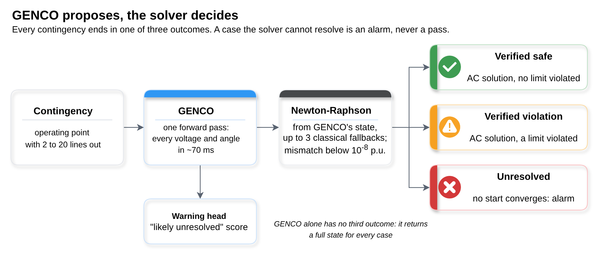

# Trust, but verify: making GENCO safe for N-k contingency screening

[](https://github.com/Alirezashooshtari/genco-trust-but-verify/actions/workflows/ci.yml)

Alireza Shooshtari, Institut de Recerca en Energia de Catalunya (IREC) · a.shooshtari1996@gmail.com

Entry to the [GENCO Challenge](https://huggingface.co/spaces/gridfm/genco-challenge) (GridFM Porto 2026).
[Model](https://huggingface.co/Alirezashooshtari/genco-texas-clustered) ·
[Demo](https://huggingface.co/spaces/Alirezashooshtari/genco-contingency-verifier)

GENCO predicts the AC power flow of a contingency in one forward pass. This repository asks when that answer can be trusted
for N-k screening on the released Texas 2,000-bus grid, and what to do when it cannot.

- **Where GENCO fails.** Under clustered outages its voltage errors grow 4 to 17 times. On 33 of 120 storms no Newton
  start converges at the actual load (continuation places the fold of the AC solution below it for 32), yet GENCO
  returns a full state for every one, with nothing to mark it as unresolved.
- **A workflow with three outcomes.** GENCO proposes a state and Newton-Raphson decides: *verified safe*, *verified
  violation* or *unresolved* (an alarm, never a pass). On a frozen test of 870 unseen contingencies it gives an AC decision
  for all 748 cases a classical solver resolves and an alarm for the 122 it cannot; GENCO alone would have been wrong in 260.
- **A second grid.** On IEEE 118, with the GENCO released for it and 708 contingencies on operating points from the
  authors' test split, the workflow again gives an AC decision for every case the classical solver resolves and an alarm
  for the 29 it cannot, with no false alarms; GENCO alone misses a decision in 52 % of cases. Clustered outages raise its
  errors less than on Texas (2.6 times), and its response to load growth is less damped (0.83 of the AC response).
- **Extending GENCO.** Fine-tuning on solver-labelled contingencies cuts missed decisions on unseen clustered outages by
  22 % for the published training seed (20 % for a second seed; the first run, made before a fix to gradient
  accumulation and kept for the record, gave 23 %). A rule on the outage alone sends only clustered outages to the
  fine-tuned model, so ordinary cases keep the released one. A warning head on GENCO's embeddings predicts unresolved
  cases with AUROC 0.96.



## Quick start

```bash
git clone https://github.com/Alirezashooshtari/genco-trust-but-verify.git
cd genco-trust-but-verify
pip install -r requirements.txt && pip install -e .

pytest                                # tests of the verification module (no data needed)
python scripts/headline_numbers.py    # every number in the write-up, recomputed from results/
python scripts/make_figures.py        # figures 2 to 5 (figure 1 is a draw.io diagram)
python scripts/build_demo.py          # the case explorer, demo/index.html
```

`headline_numbers.py` writes `results/headline_numbers.csv`, one row per claim with the file it comes from. CI recomputes
it on every push and fails if any value changes.

## Using the verification module

```python
from genco_verify import Verifier, case_from_tables

case = case_from_tables(bus, branch, removed_idx=lines_out)     # one scenario of the released tables, lines removed
result = Verifier(case).run(genco_vm=vm, genco_va_deg=va)        # vm, va: GENCO's predicted state

result.status             # "verified_safe" | "verified_violation" | "unresolved"
result.limits             # overloaded lines and voltage violations of the AC state
result.unresolved_reason  # why no start converged, when unresolved
result.history            # every start tried: iterations, mismatch, time
```

`Verifier(case, {"enforce_q_limits": True})` enforces generator reactive limits (pass the generator table to
`case_from_tables`), and `{"branch_check": True}` runs every start and reports when they reach different AC solutions.
`policy_name="classical"` runs the same check without GENCO. Newton-Raphson uses lightsim2grid when it is installed
(`pip install -e ".[fast]"`) and a SciPy implementation otherwise.

## Layout

```
src/genco_verify/   the verification workflow (numpy, scipy; lightsim2grid optional)
tests/              tests of every outcome and option on a three-bus grid
notebooks/          the Colab notebooks that produced the results (see notebooks/README.md)
results/            what the numbers and figures need from each notebook run, plus the analyses in results/analysis/
scripts/            headline numbers, figures, demo, warning ablation, Hugging Face upload
figures/            the five figures of the write-up (PNG and SVG)
demo/               the case explorer (also the Hugging Face Space)
environment/        Colab setup, pinned upstream revisions, data and checkpoint hashes
release/            the model card of the fine-tuned model
```

## Reproducing from scratch

Each notebook runs on a fresh Colab runtime from the public data and checkpoint, with gridfm-graphkit pinned to commit
`95b90ee` and `gridfm/genco-pf-contingency` to revision `5c625b0`. `environment/colab.md` describes the setup and what
reproduces exactly; `notebooks/README.md` maps each notebook to its results folder and figure. The warning ablation also
needs the feature matrices published with the model:

```bash
python scripts/warning_ablation.py --features-dir <folder with features_released.npz and features_finetuned.npz>
```

## Limitations

- **Steady state only.** The check is an AC power flow: no dynamics, protection or remedial actions.
- **Unresolved is not infeasible.** It means none of the tested starts converged within the iteration cap. For the storms,
  continuation places the fold of the AC solution below the actual load in 32 of the 33 such cases.
- **More than one AC solution.** In 2 of the 748 verified frozen-test cases the starts reached different solutions; the
  module reports such cases instead of choosing silently.
- **No speed-up on this grid.** GENCO plus verification takes 86 ms per case (median), the classical solve 13 ms.
- **The warning fades near the fold.** Within 5 % of it the AUROC is 0.57. The warning orders the work; the solver still
  runs on every case.
- **The fine-tuned model is a specialist.** It is less accurate on ordinary scenarios (median worst-bus error 0.0013 to
  0.0036 p.u.), so ordinary outages should stay with the released model.
- **Two grids.** Texas 2,000-bus and IEEE 118; on IEEE 118 every operating point already has one generator out.

## Credits and licence

GENCO, gridfm-graphkit and the Texas test data are by the GridFM team (`gridfm/genco-pf-contingency`, Apache-2.0).
lightsim2grid is by RTE France; PYPOWER, a port of MATPOWER, is used for the independent check. The code in this repository
is MIT licensed; `results/` holds numbers derived from the public data, not the data itself.

If you use this work, please cite it as described in `CITATION.cff`.
